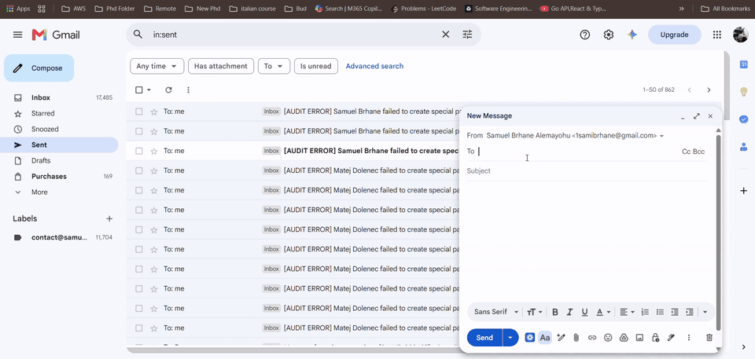
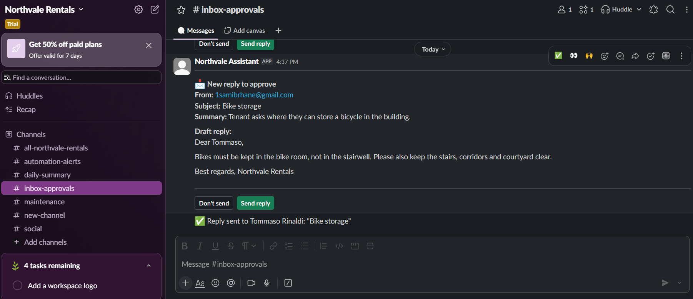
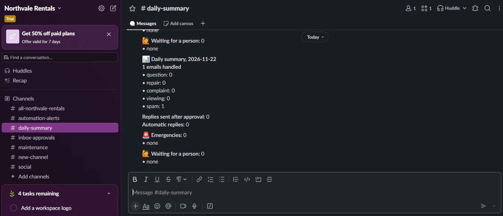
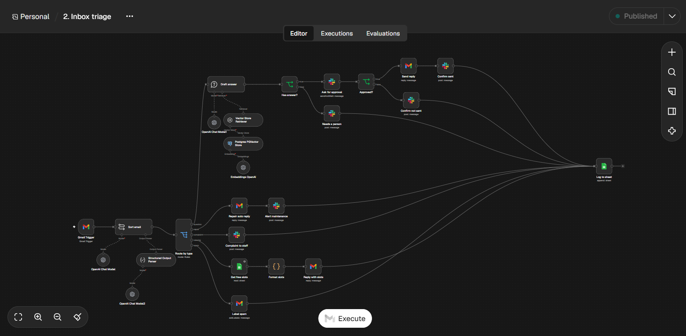
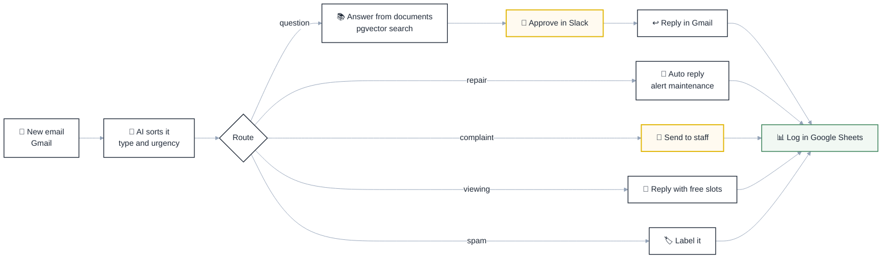
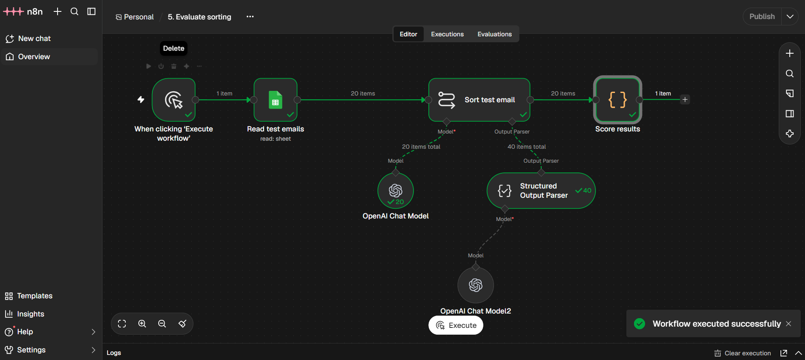

# AI Inbox Automation with n8n

An n8n automation that runs the email inbox of a small property management company. It reads every incoming email, sorts it with AI, answers tenant questions from the company's own documents, and asks the office team to approve each reply in Slack before it is sent. Repairs, complaints, viewing requests and spam are each handled on their own path, and every email is logged in Google Sheets.

The example business is Northvale Rentals, a fictional company that manages rental flats.



| Approval in Slack | Daily summary |
|---|---|
|  |  |



## What it does

| Email type | What happens |
|---|---|
| Question | The AI writes a reply using only the company documents. The draft goes to Slack with **Send reply** and **Don't send** buttons. Approved replies are sent in the same Gmail thread. |
| Question the documents don't cover | No draft. Slack gets a "needs a person" message. |
| Repair | The tenant gets an instant acknowledgement. The maintenance channel gets the details. Leaks, no heating, gas smells and similar are flagged as emergencies. |
| Complaint | Sent to the team for a personal reply, with no AI draft. |
| Viewing request | The person gets the free viewing times from a Google Sheet. |
| Spam | Labelled in Gmail, with no reply. |

The only emails sent without a person's approval are fixed acknowledgements. Anything the AI writes waits for a click.

Every email becomes a row in Google Sheets with its type, urgency, summary, draft and status. A daily report at 18:00 posts the counts, emergencies and anything still waiting to Slack. If any workflow fails, an alert names the workflow, the node and the error.

## Workflows

| Workflow | Trigger | Purpose |
|---|---|---|
| `1-load-documents` | Manual | Reads the policy documents, splits them into chunks and stores their embeddings in Postgres with pgvector |
| `2-inbox-triage` | New Gmail email | Sorts, routes, drafts, asks for approval, replies and logs |
| `3-daily-summary` | Every day at 18:00 | Builds the daily report from the log sheet |
| `4-error-alert` | Any workflow failing | Posts the error to Slack |
| `5-evaluate-sorting` | Manual | Runs the sorting prompt on 20 labelled test emails and scores it |

## How it works



**Structured sorting.** The sorting step uses a JSON schema, so the AI always returns the same fields: category, urgency, a one-line summary, the tenant's name, the flat code and the language. The routing then works on those fields, never on free text.

**Answers only from the documents.** The question path searches the five policy documents in pgvector and tells the model to answer only from what it finds. If the documents don't cover the question, it returns `NO_ANSWER` and the email goes to a person.

**People stay in control.** Every AI-written reply waits for approval in Slack, and the channel shows whether each one was sent or rejected.

**Logged and monitored.** The Google Sheet is the record of everything that happened, the daily summary reads from it, and a separate error workflow catches failures.

## Evaluation

`5-evaluate-sorting` runs the same prompt and schema as the live workflow on 20 labelled emails in `eval/test-emails.csv`: questions, repairs, complaints, viewing requests and spam, including emails in Italian and a question the documents don't cover.

| Metric | Result |
|---|---|
| Category accuracy | 20/20 (100%) |
| Urgency accuracy | 20/20 (100%) |
| Emergencies caught | 3/3 |



## Stack

- **Automation:** n8n (self-hosted, Docker)
- **AI:** OpenAI gpt-5.4-mini for sorting and drafting, text-embedding-3-small for search
- **Vector search:** Postgres with pgvector
- **Apps:** Gmail, Slack, Google Sheets

## Run it yourself

You need Docker, an OpenAI API key, a Gmail account, a Slack workspace and Google Sheets.

1. Start n8n and Postgres:

```bash
cp .env.example .env    # then set a password and an encryption key
docker compose up -d
```

2. Open http://localhost:5678 and create the owner account.
3. Add credentials in n8n:
   - **OpenAI**
   - **Postgres:** host `postgres`, database, user and password from `.env`
   - **Gmail** and **Google Sheets:** a Google Cloud OAuth client with the Gmail, Sheets and Drive APIs turned on, and the redirect URL `http://localhost:5678/rest/oauth2-credential/callback`
   - **Slack:** a bot token with `chat:write`, `chat:write.public`, `channels:read`, `groups:read` and `users:read`
4. Create a Google Sheet with the tabs `Inbox log`, `Viewing slots` and `Test emails`, and Slack channels `#inbox-approvals`, `#maintenance`, `#daily-summary` and `#automation-alerts`.
5. Import the five files from `workflows/` (**Workflows → Import from file**), and pick your credentials, sheet and channels in each node.
6. Run `1-load-documents` once, then publish `4-error-alert`, `2-inbox-triage` and `3-daily-summary`.

To change what the AI knows, edit the files in `docs/` and run `1-load-documents` again.

## Project structure

```
docs/                policy documents the AI answers from
workflows/           exported n8n workflows, ready to import
eval/                labelled test emails and results
db/init.sql          enables pgvector
docker-compose.yml   n8n and Postgres
screenshots/         screenshots and demo
```